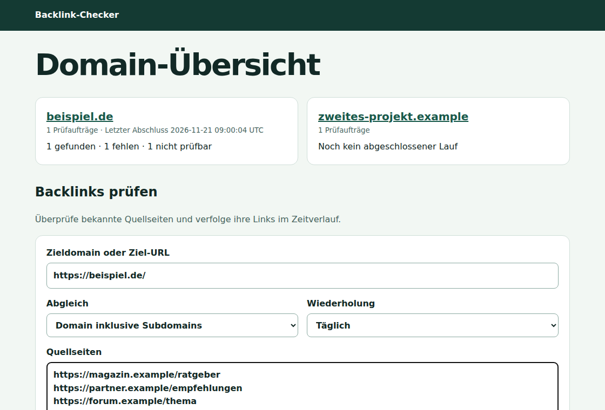
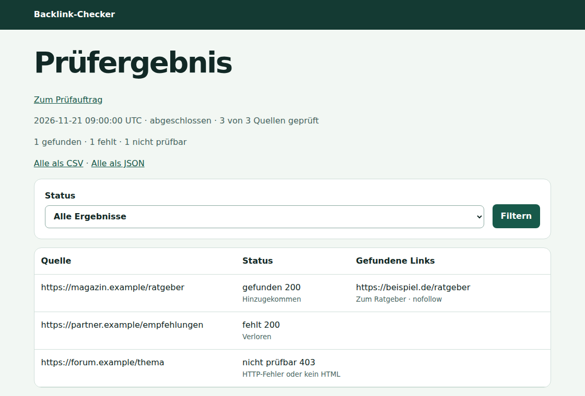

# Backlink-Checker

Selbst gehostete Web-App zur Prüfung und Überwachung bekannter Backlinks. Prüfe öffentliche Quellseiten gegen eine Domain einschließlich Subdomains oder gegen eine exakte Ziel-URL.

- Bis zu 25.000 eindeutige Quellseiten je Auftrag per CSV-, TSV- oder Textimport. Quellen lassen sich auch direkt einfügen.
- Einmalige und automatische Prüfungen im Stunden-, Tages- oder Wochenrhythmus.
- HTTP-Status, Weiterleitungen, Ziel-URL, Ankertext und Linkattribute wie `nofollow`, `sponsored` und `ugc`.
- Verlauf mit Markierung neu hinzugekommener und verlorener Backlinks beim Vergleich aufeinanderfolgender Prüfläufe. Abruffehler werden separat ausgewiesen.
- CSV- und JSON-Export je Lauf. SQLite-Datenbank im Docker-Volume.

Die App prüft Links im ausgelieferten HTML. Für die erstmalige Recherche von Quellseiten brauchst du etwa einen Export aus einem Backlink-Index. Links, die erst durch JavaScript entstehen, werden nicht erfasst. Geprüft wird das im Link hinterlegte Ziel. Weiterleitungen der Quellseite werden verfolgt.

## Docker Compose aus dem Projektordner
 
Wenn du den Quellcode noch nicht lokal hast, kannst du ihn in demselben Befehl abrufen und starten:

```bash
git clone https://github.com/immobilienmakler/backlink-checker.git && cd backlink-checker && docker compose up -d --build
```

Mit bereits ausgechecktem Projekt genügt:

```bash
docker compose up -d --build
```

Öffne [localhost:8080](http://localhost:8080). Die Basis ist für Linux AMD64 und ARM64 verfügbar.

## GitHub und GitHub Container Registry

Lege ein GitHub-Repository an und lade den Projektinhalt einschließlich `.github/workflows/container.yml` auf `main` hoch. Die Action prüft die App und baut und veröffentlicht das Image für `linux/amd64` und `linux/arm64`. Stelle das GHCR-Paket in den Paket-Einstellungen auf **Public**, wenn der Abruf ohne Anmeldung funktionieren soll. Das Projekt verwendet das unten angegebene Image.

**Docker aus der Registry mit einem Befehl**

```bash
docker run -d --name backlink-checker --restart unless-stopped --read-only --cap-drop ALL --security-opt no-new-privileges:true -p 127.0.0.1:8080:8080 -v backlinks:/data ghcr.io/immobilienmakler/backlink-checker:latest
```

**Portainer auf Docker Standalone**

1. Öffne **Stacks → Add stack → Git repository** und trage die GitHub-Repository-URL ein.
2. Verwende `refs/heads/main` und den Compose-Pfad `portainer.yaml`.
3. Setze die Umgebungsvariable `BACKLINK_IMAGE=ghcr.io/immobilienmakler/backlink-checker:latest` und klicke auf **Deploy the stack**.

Alternativ kannst du `portainer.yaml` als Stack-Datei hochladen. Bei einem privaten Image braucht die Docker-Umgebung GHCR-Zugangsdaten.

## Zugriff und Daten

Die mitgelieferten Befehle binden den Webport an die Loopback-Adresse des Docker-Hosts. Bei einem entfernten Host kannst du per SSH-Portweiterleitung darauf zugreifen:

```bash
ssh -L 8080:127.0.0.1:8080 user@docker-host
```

Für einen Reverse Proxy verwende HTTPS und setze `APP_PASSWORD` auf ein langes Passwort. Bei der HTTP-Basic-Anmeldung ist der Benutzername frei wählbar. Compose unterstützt außerdem `WEB_PORT` und `BIND_IP`. Der Abruf externer Quellen erfolgt über öffentliche HTTP(S)-Adressen; private und reservierte IP-Adressen werden blockiert.

Die Datenbank liegt unter `/data/backlinks.sqlite3`. Für eine einfache konsistente Volume-Sicherung stoppe den Container vor dem Kopieren. Ein unterbrochener Prüflauf setzt beim nächsten Start bei den noch nicht gespeicherten Quellen fort. Die Standardkonfiguration ist für eine App-Instanz pro Datenvolume gedacht.

## Lokal testen

Python 3.11 oder neuer, ohne zusätzliche Python-Pakete.

```bash
python3 -m unittest -v
python3 app.py
```

[Docker Multi-Plattform-Builds](https://docs.docker.com/build/building/multi-platform/) · [Portainer-Stacks](https://docs.portainer.io/user/docker/stacks/add)

## Vom ersten Check bis zum Export

1. Öffne die Weboberfläche. Trage deine Domain ein, zum Beispiel `https://beispiel.de`.
2. Wähle **Domain inklusive Subdomains**, wenn Links zu allen Unterseiten zählen sollen. Wähle **Exakte Ziel-URL**, um eine bestimmte Seite zu prüfen.
3. Kopiere die Quell-URLs aus deiner Backlink-Liste in das Textfeld, eine pro Zeile.
4. Wähle ein Prüfintervall und klicke auf **Prüfung starten**. Öffne den neuesten Lauf im Verlauf. Wenn der Lauf noch läuft, aktualisiere die Seite.
5. **Gefunden** bedeutet, dass die Quellseite mindestens einen passenden Link enthält. **Fehlt** bedeutet, dass die HTML-Seite erfolgreich abgerufen wurde und kein entsprechender Link gefunden wurde. **Nicht prüfbar** umfasst unter anderem Zeitüberschreitungen, HTTP-Fehler und Antworten ohne HTML.
6. Über **CSV** oder **JSON** kannst du die Ergebnisse des Laufs herunterladen. **Erneut prüfen** startet eine zusätzliche Prüfung.

## Aktualisieren und Fehler eingrenzen

- **Docker Compose aus dem Quellcode:** `git pull && docker compose up -d --build`.
- **Portainer:** Stack öffnen und mit erneutem Image-Pull bereitstellen. Behalte denselben Stack-Namen und das Volume.
- **Container startet nicht:** `docker logs backlink-checker` bei `docker run` oder `docker compose logs backlink-checker` bei Compose.
- **Port 8080 belegt:** Verwende in Compose `WEB_PORT=8081`. Bei `docker run` ändere die Zuordnung auf `-p 127.0.0.1:8081:8080`.
- **GHCR meldet Zugriff verweigert:** Prüfe die Sichtbarkeit des Pakets oder nutze die Installation aus dem Quellcode.
- **Auf einem entfernten Server:** `localhost` bezeichnet den jeweiligen Rechner. Verwende die oben gezeigte SSH-Portweiterleitung oder einen HTTPS-Reverse-Proxy mit konfiguriertem App-Passwort.

## Screenshots





## Lizenz

[MIT](LICENSE)

## Projektwebsite veröffentlichen

Der Inhalt der [Projektwebsite](https://immobilienmakler.github.io/backlink-checker/) liegt unter [docs/](docs/). Wähle in den [Pages-Einstellungen](https://github.com/immobilienmakler/backlink-checker/settings/pages) unter **Build and deployment → Source** die Option **GitHub Actions**. Starte bei Bedarf den Workflow [GitHub Pages](https://github.com/immobilienmakler/backlink-checker/actions/workflows/pages.yml) über **Run workflow**. Der Workflow **Screenshots** rendert Startseite und Bericht aus der echten App mit Beispieldaten.

## Mehrere Domains verwalten

Die Startseite gruppiert Prüfaufträge nach Ziel-Hostname. `www.beispiel.de` und `beispiel.de` erscheinen zusammen. Andere Subdomains erhalten einen eigenen Eintrag, wenn du sie ausdrücklich als Ziel erfasst. Der Domain-Abgleich eines Auftrags berücksichtigt weiterhin die Subdomains seines jeweiligen Ziels.

Öffne eine Domain, um ihre Aufträge, Zeitpläne und jeweils letzten abgeschlossenen Ergebnisse zu sehen. **Alle Aufträge dieser Domain prüfen** plant ausschließlich die Aufträge dieser Domain ein. Die Übersicht summiert die letzten abgeschlossenen Ergebnisse pro Auftrag. Eine Quellseite, die in mehreren Aufträgen vorkommt, wird entsprechend mehrfach gezählt.

Beim Upgrade mit demselben Container-Volume erscheinen vorhandene Aufträge automatisch in der neuen Übersicht. In Portainer aktualisierst du den bestehenden Stack mit erneutem Image-Pull.

### Dashboard

Das Dashboard zeigt die Zahl der Domains und Prüfaufträge, geprüfte Quellen mit gefundenen oder fehlenden Backlinks sowie Abruffehler. Die Domain-Tabelle enthält außerdem hinzugekommene und verlorene Links, den letzten abgeschlossenen Bericht und den nächsten Prüftermin. Du kannst nach Domain suchen oder gezielt fehlende, verlorene und nicht prüfbare Backlinks filtern.

Der Vergleich verwendet pro Auftrag die letzten zwei abgeschlossenen Läufe. Eine Quelle zählt als hinzugekommen oder verloren, wenn sie zwischen **fehlt** und **gefunden** wechselt. Abruffehler bleiben separat sichtbar.

### Große Quellenlisten prüfen

1. Erstelle einen Auftrag für die Domain und lade deine Quellenliste hoch. Textdateien enthalten eine URL je Zeile. CSV und TSV brauchen eine Kopfzeile, etwa `Quell-URL`, `Source URL` oder `Referring Page URL`. Speichere die Datei als UTF-8. Komma, Semikolon und Tabulator werden unterstützt.
2. Die App entfernt doppelte normalisierte URLs. Ein Auftrag unterstützt bis zu **25.000 eindeutige Quell-URLs**. Für größere Bestände kannst du mehrere Aufträge unter derselben Domain zusammenfassen. Die maximale Größe eines Uploads beträgt **16 MiB**. Bei einem Reverse Proxy muss dessen Upload-Limit ebenfalls ausreichen.
3. Öffne den laufenden Bericht, um den Fortschritt zu sehen. Pro Auftrag werden bis zu 16 Quellen parallel geprüft, darunter höchstens zwei Start-URLs pro Quellhost gleichzeitig. Der Worker wechselt nach jedem Arbeitsblock zwischen offenen Aufträgen. Die Laufzeit hängt vor allem von Antwortzeiten und der Verteilung der Quellen auf Hosts ab.
4. Filtere die Ergebnisse nach Status oder blättere durch die Seiten mit je 100 Quellen. CSV und JSON enthalten alle bis zum Exportstart vorliegenden Ergebnisse des Laufs. Bei einem Neustart werden bereits gespeicherte Quellen desselben Laufs übersprungen.

Die Kapazitätsgrenze zählt Quell-URLs. Die Anzahl der tatsächlich gefundenen Links kann davon abweichen. Wiederholungsintervalle werden jeweils ab dem Abschluss des letzten Laufs berechnet.

### Quellen pflegen und Änderungen bearbeiten

- Öffne einen Prüfauftrag und klicke auf **Quellen verwalten**. Ergänze eine CSV-, TSV- oder Textdatei oder füge URLs ein. Duplikate im Auftrag werden beim Import entfernt. Quellen, die auch in einem anderen Auftrag derselben Domain stehen, sind markiert. Das ist sinnvoll, wenn eine Quelle mehrere Zielseiten verlinkt.
- Über die URL-Suche findest du einzelne Quellen. **Für künftige Prüfungen entfernen** entfernt sie aus der aktiven Liste. Bereits gespeicherte Ergebnisse und schon gestartete Läufe behalten ihre ursprüngliche Quellenliste. Du kannst eine entfernte URL später erneut importieren.
- Unter **Gezielt nachprüfen** wählst du fehlende Backlinks, Abruffehler oder beides. Eine einzelne URL kannst du über **Quellen verwalten → Nachprüfen** auswählen. Die Nachprüfung ruft diese und noch ungeprüfte Quellen ab. Die übrigen aktiven Ergebnisse übernimmt sie aus dem letzten abgeschlossenen Lauf und weist deren Anzahl separat aus. Der Zeitplan der nächsten Vollprüfung bleibt bestehen. HTTP 429 und 503 werden einmal wiederholt, wenn die angegebene Wartezeit höchstens zehn Sekunden beträgt. Ohne gültigen `Retry-After` wartet die App zwei Sekunden.
- Im Prüfbericht kannst du **Änderung** nach hinzugekommenen, verlorenen oder wiedergefundenen Backlinks und geänderten Linkdetails filtern. Ziel-URL, Ankertext und `rel` werden als Menge verglichen, sodass eine andere Reihenfolge derselben Links keine Änderung auslöst. **Änderungen als CSV** exportiert die gefilterte Arbeitsliste über alle Seiten des Berichts.

### Dubletten pro Domain bereinigen

Öffne die Domain und klicke auf **Dubletten prüfen und bereinigen**. Die Vorschau zeigt je betroffenem Auftrag, wie viele Quell-URLs entfernt werden. Bereinigt werden identische Quell-URLs bei gleichem Domain-Abgleich oder gleicher exakter Ziel-URL. Ein abweichender Ziel-Hostname oder ein anderer Abgleich zählt als eigenständige Prüfung.

Bei mehreren gleichwertigen Aufträgen bleibt die Quelle bevorzugt im Auftrag mit dem kürzesten automatischen Intervall. Bei gleichem Intervall hat der älteste Auftrag Vorrang. Aufträge ohne verbleibende Quellen pausieren. Bereits gespeicherte Berichte und laufende Prüfungen bleiben erhalten. Ergänze Quellen, um einen leeren Auftrag wieder zu aktivieren.

### Große Prüfläufe steuern

Im laufenden Bericht findest du eine Fortschrittsanzeige und die Schaltflächen **Prüfung pausieren** und **Prüfung fortsetzen**. Eine Pause greift nach dem aktuellen Arbeitsblock. Bereits angestoßene Abrufe dürfen fertig werden und werden gespeichert. Auch nach einem Container-Neustart bleibt ein pausierter Lauf pausiert.

Der Worker wechselt zwischen offenen Aufträgen. Pro Arbeitsblock verarbeitet er bis zu 128 Quellen und startet nach etwa zehn Sekunden keine weiteren Abrufe für diesen Block. Angefangene Abrufe können länger dauern. Danach ist der nächste offene Auftrag an der Reihe. Dadurch können kleinere Prüfungen abschließen, während ein großer Auftrag noch läuft. Die Begrenzung auf 16 parallele Abrufe und zwei Start-URLs pro Quellhost gilt weiterhin.
